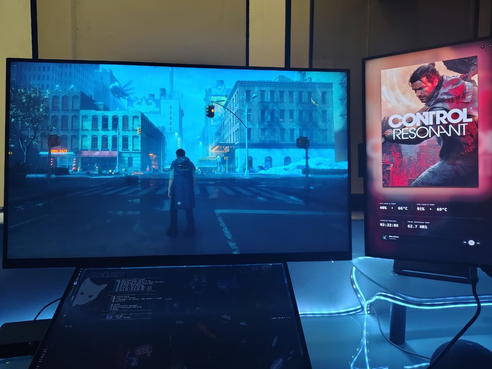
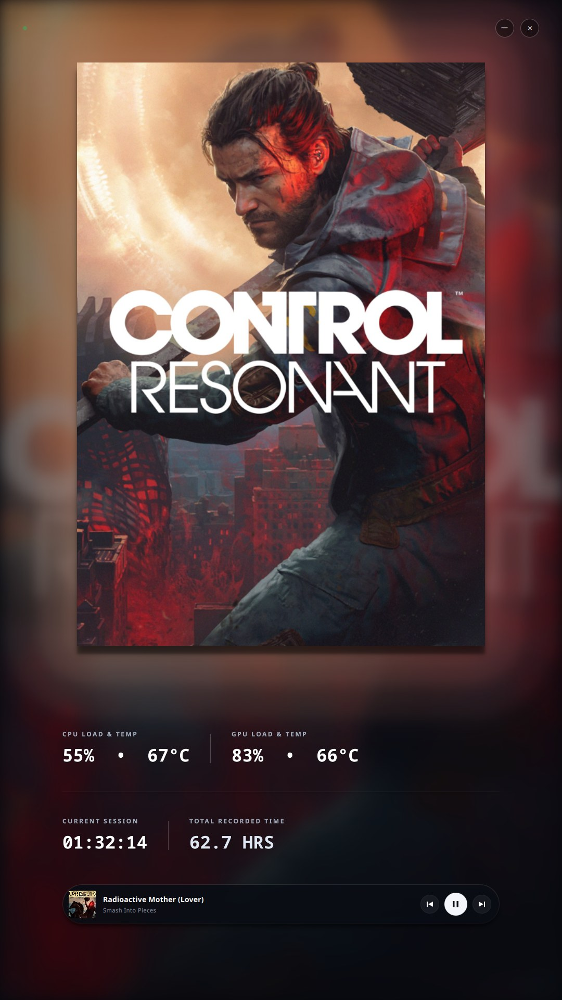
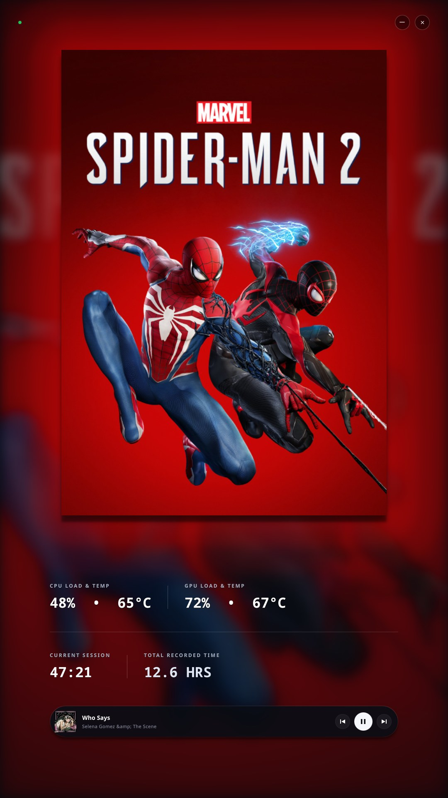
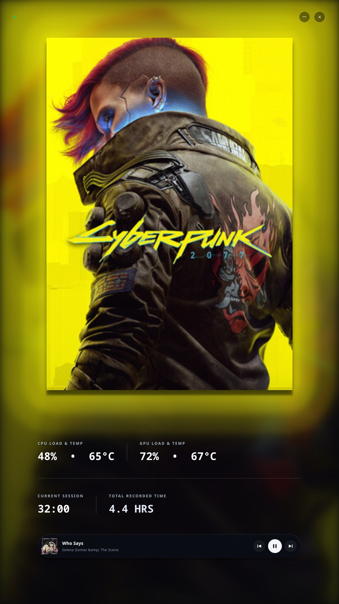
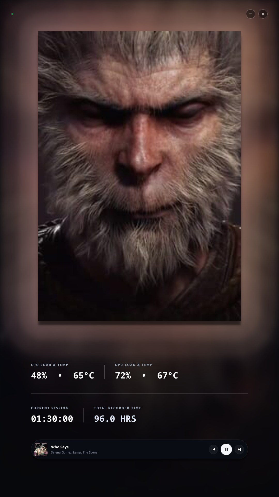

# GameDeck

Overlay for secondary or portrait monitors on Linux (Wayland / Hyprland) built with [Quickshell](https://outfoxxed.me/quickshell/).

Detects active games and displays high-res cover art, ambient backlighting sampled from the artwork perimeter, live CPU/GPU telemetry (usage and temperatures), session and total playtime, and a built-in universal media player.



## Features

- **Automatic game detection:** Identifies games on Hyprland (Steam, Lutris, Heroic) without manual configuration.
- **Perimeter ambient backlighting:** 360° concentric bulb glow dynamically sampled from the cover palette, ignoring title text highlights.
- **Hardware telemetry:** Real-time CPU & GPU load and temperature monitor (NVIDIA SMI, AMD/Intel drm sysfs, and `lm_sensors`).
- **Session & playtime counter:** Tracks current run time alongside total accumulated game launcher playtime.
- **Haptic media dock:** Universal MPRIS media player (YouTube Music, Spotify, browsers) with real-time push events and vector playback controls.
- **Non-intrusive overlay:** Wayland layer-shell overlay without grabbing mouse focus from the active game.
- **Controls:** Minimizes to an unobtrusive status pill or closes on demand.

## Preview Gallery

<p align="center">
  
  
  
  
</p>

## Requirements

- Wayland compositor (tested on Hyprland)
- [Quickshell](https://outfoxxed.me/quickshell/) (`qs`)
- Python 3 with `Pillow`
- `playerctl` (for universal media controls)
- `lm_sensors` (for CPU temp) and `nvidia-smi` or DRM drivers for GPU

## Usage

### Standalone mode

```bash
git clone https://github.com/zekkencito/gamedeck.git
cd gamedeck
qs -p shell.qml
```

### Integrated into an existing Quickshell setup (e.g. Caelestia)

Copy files to your configuration directory:

```bash
cp -r modules/* ~/.config/quickshell/caelestia/modules/background/
cp -r scripts/* ~/.config/quickshell/caelestia/scripts/
```

Add the window to your `shell.qml`:

```qml
import "modules/background"

ShellRoot {
    GameDeckWindow {}
}
```

## Configuration

Customize display target and library paths in `config.json`:

```json
{
  "target_screen": "auto",
  "screen_filter": ["DP-3", "arzopa"],
  "telemetry": {
    "poll_interval_sec": 1.2,
    "game_check_interval_sec": 2.0
  },
  "library_paths": {
    "steam": "~/.local/share/Steam",
    "lutris": "~/.local/share/lutris",
    "heroic": "~/.config/heroic"
  }
}
```

## License

MIT
